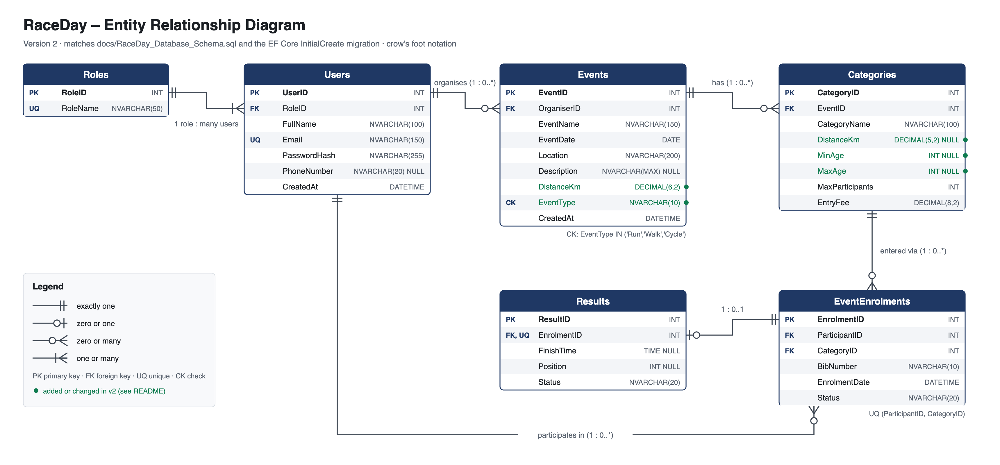

# RaceDay API

RESTful API for **RaceDay**, a race-event management system. Organisers create events (runs, walks and cycles), define age or distance categories, view enrolments and capture results. Participants enter events by choosing a category and view their own results.

Built with **ASP.NET Core 8 Web API**, **Entity Framework Core 8 (code-first)** and **SQL Server**. The API uses **session-based authentication with role-based access**, is documented and testable through **Swagger**, and is covered by **125 automated tests** that run on every push through **GitHub Actions**.



---

## Contents

1. [Repository layout](#repository-layout)
2. [Running the API](#running-the-api)
3. [Trying it in Swagger](#trying-it-in-swagger)
4. [Authentication and role-based access](#authentication-and-role-based-access)
5. [Endpoints](#endpoints)
6. [Tests and CI/CD](#tests-and-cicd)
7. [Differences from the Part 1 plan](#differences-from-the-part-1-plan)

---

## Repository layout

```
RaceDay.sln
├── src/RaceDay.Api/                 ASP.NET Core Web API
│   ├── Auth/                        Session authentication handler, role constants
│   ├── Controllers/                 Auth, Users, Events, Categories, Enrolments, Results
│   ├── Data/                        DbContext, EF Core migrations, demo data seeder
│   ├── Dtos/                        Request/response models (with validation)
│   ├── Models/                      Entities: Role, User, Event, Category, EventEnrolment, Result
│   └── Swagger/                     Adds "Role required" + 401/403 info to every endpoint
├── tests/RaceDay.Api.Tests/
│   ├── Integration/                 Tests against the running API (HTTP + session cookies)
│   └── Unit/                        Password hashing and validation rules
├── docs/
│   ├── ERD_RaceDay.png / .svg       Entity relationship diagram (v2)
│   ├── RaceDay_Database_Schema.sql  SQL Server script (v2, matches the EF migration exactly)
│   ├── API_Endpoint_Plan.md         Endpoint plan as submitted in Part 1
│   └── part1-submitted/             Part 1 ERD, SQL script and plan, unchanged, for reference
├── tools/make_erd.py                Script that draws the ERD
└── .github/workflows/dotnet.yml     CI: build + run all tests
```

## Running the API

### Visual Studio (recommended)

1. Open `RaceDay.sln` in Visual Studio 2022 (17.8 or later, with the ASP.NET workload and .NET 8 SDK).
2. The connection string in `src/RaceDay.Api/appsettings.json` points to SQL Server LocalDB, which installs with Visual Studio:
   ```
   Server=(localdb)\MSSQLLocalDB;Database=RaceDayDB;Trusted_Connection=True;TrustServerCertificate=True
   ```
   To use a full SQL Server instance, change `ConnectionStrings:RaceDayDB`, e.g. `Server=localhost;Database=RaceDayDB;Trusted_Connection=True;TrustServerCertificate=True`.
3. Set **RaceDay.Api** as the startup project and press **F5**. The browser opens on Swagger.

On first start the API **applies the EF Core migration automatically** (creates `RaceDayDB` and all tables) and **seeds demo data**. There is no need to run `Update-Database` manually, although it works too (`Update-Database` in the Package Manager Console, or `dotnet ef database update --project src/RaceDay.Api`).

**Using the SQL script instead:** `docs/RaceDay_Database_Schema.sql` builds the same schema in SSMS and records the migration as applied, so the API runs against a script-created database without changes. The script and the migration produce identical tables, keys, constraints and indexes.

### Command line

```bash
dotnet run --project src/RaceDay.Api
# Swagger: http://localhost:5104/swagger
```

No SQL Server available (e.g. macOS)? Run against an in-memory database. Data is lost when the API stops:

```bash
dotnet run --project src/RaceDay.Api -- --Database:Provider=InMemory
```

## Trying it in Swagger

Swagger UI lists every endpoint with its purpose, **the role it requires**, the request body it expects (with example values) and every response it can return.

1. Expand **POST /api/auth/login** → *Try it out* → log in with a demo account (below).
2. The browser now holds the session cookie, so **every later request from the Swagger page is authenticated** as that user. No token needs to be copied.
3. To switch users, call **POST /api/auth/logout** and log in again.

| Role | Email | Password |
|---|---|---|
| Organiser | `thabo.mokoena@raceday.co.za` | `Password123!` |
| Organiser | `lindiwe.dube@raceday.co.za` | `Password123!` |
| Participant | `sarah.botha@example.com` | `Password123!` |
| Participant | `michael.vanwyk@example.com` | `Password123!` |
| Admin | `admin@raceday.co.za` | `Admin123!` |

The demo data contains two upcoming events and one completed event with results. Thabo owns events 1 and 2; Lindiwe owns event 3.

## Authentication and role-based access

**Registration.** `POST /api/auth/register` takes the user's personal details and a role. Only **Organiser** or **Participant** can be chosen; any other value, including **Admin**, is rejected with `400`. Self-assigning a privileged role is therefore impossible. The single Admin account is created from configuration (`Seed:AdminEmail` / `Seed:AdminPassword`), never through the API.

**Password storage.** Passwords are hashed with ASP.NET Core Identity's `PasswordHasher` (PBKDF2-HMAC-SHA512, 100,000 iterations, random 128-bit salt per user). Only the hash is stored in `Users.PasswordHash`; the plain password is never stored, logged or returned.

**Session management.** `POST /api/auth/login` verifies the credentials and writes the user's ID, role, name and email into a **server-side ASP.NET Core session**. The client receives only an opaque, `HttpOnly` session cookie (`.RaceDay.Session`, 30-minute idle timeout). A custom `SessionAuthenticationHandler` reads the session on every request and builds the user's identity and role claims, which means:

- `[Authorize]` protects non-public endpoints: no valid session gives **401 Unauthorized**.
- `[Authorize(Roles = "Organiser")]` / `[Authorize(Roles = "Participant")]` separate the two roles: the wrong role gives **403 Forbidden**. Organiser functionality is not accessible to Participants, and vice versa.
- **Ownership checks** in the controllers stop an Organiser from managing another Organiser's events, categories, enrolment lists or results (**403**), and stop a Participant from withdrawing someone else's enrolment.

## Endpoints

All 21 planned endpoints are implemented with the planned routes and methods, plus 2 additions marked ➕ (23 in total). Swagger shows full request/response details.

| Method | Route | Role | Purpose |
|---|---|---|---|
| POST | `/api/auth/register` | Public | Register as Organiser or Participant |
| POST | `/api/auth/login` | Public | Log in, start session |
| POST | `/api/auth/logout` ➕ | Public | End session |
| GET | `/api/users/me` | Any logged in | View own profile |
| PUT | `/api/users/me` | Any logged in | Update own profile |
| GET | `/api/users/{id}` | Admin | View any user |
| POST | `/api/events` | Organiser | Create event |
| GET | `/api/events` | Public | List upcoming events (`?includePast=true` for all) |
| GET | `/api/events/{id}` | Public | View event |
| PUT | `/api/events/{id}` | Organiser (owner) | Update event |
| DELETE | `/api/events/{id}` | Organiser (owner) | Delete event and its categories |
| POST | `/api/events/{eventId}/categories` | Organiser (owner) | Add age/distance category |
| GET | `/api/events/{eventId}/categories` | Public | List event's categories |
| PUT | `/api/categories/{id}` | Organiser (owner) | Update category |
| DELETE | `/api/categories/{id}` | Organiser (owner) | Delete category |
| POST | `/api/categories/{categoryId}/enrol` | Participant | Enter event via category |
| GET | `/api/users/me/enrolments` | Participant | Own enrolments |
| GET | `/api/categories/{categoryId}/enrolments` | Organiser (owner) | Enrolments in a category |
| GET | `/api/events/{eventId}/enrolments` ➕ | Organiser (owner) | All enrolments for an event |
| DELETE | `/api/enrolments/{id}` | Participant (owner) or Admin | Withdraw enrolment |
| POST | `/api/enrolments/{id}/result` | Organiser (owner) | Capture/update finish time and position |
| GET | `/api/categories/{categoryId}/results` | Public | Category leaderboard |
| GET | `/api/users/me/results` | Participant | Own results |

## Tests and CI/CD

```bash
dotnet test
```

The tests start the real API in memory with `WebApplicationFactory`, using the same middleware, session, authentication and controllers, backed by an isolated EF Core in-memory database, so they need no SQL Server. Each test client keeps its own cookie jar, so it behaves like a logged-in browser. **125 tests**, covering success and failure cases for:

| Area | File | Examples |
|---|---|---|
| Registration and login | `AuthenticationTests` | 201 per role; duplicate email 409; Admin/invalid role 400; password stored hashed; login 200 sets HttpOnly cookie; wrong password 401; logout ends session; forged cookie rejected |
| Event management | `EventManagementTests` | Organiser creates/updates/deletes own events; cannot touch another Organiser's (403); invalid type/missing fields 400; 404s; public viewing |
| Role-based access | `RoleAccessTests` | Every protected endpoint returns 401 when not logged in; every Organiser endpoint returns 403 for Participants; every Participant endpoint returns 403 for Organisers |
| Event enrolments | `EnrolmentTests` | Participant enrols (201) and the Participant–event–category link is verified in the database; duplicate 409; full 409; past event 400; Organiser views by category/event; withdrawal rules |
| Categories, results, profile | `CategoryTests`, `ResultTests`, `ProfileTests` | Age vs distance categories; result capture/update; position clash 409; own results only; leaderboard order |
| Unit | `PasswordHashingTests`, `RequestValidationTests` | Salted hashing; validation rules |

**GitHub Actions** (`.github/workflows/dotnet.yml`) restores, builds and runs the full test suite on every push and pull request to `main`/`master`, and uploads the test results as an artifact.

## Differences from the Part 1 plan

Part 2's brief added requirements that the Part 1 plan and schema did not yet cover. Every difference is listed here with its reason. Nothing else differs from the plan.

### API endpoint plan

| # | Part 1 plan | Implemented | Reason |
|---|---|---|---|
| 1 | Login issues a **JWT**; response `{ token, user }` | Login starts a **server-side session**; response `{ message, user }` and an HttpOnly session cookie | Part 2 requires session management to keep the user's authenticated state and role |
| 2 | — | **POST `/api/auth/logout`** added | A session-based system needs a way to end the session |
| 3 | Enrolments viewable per category only | **GET `/api/events/{eventId}/enrolments`** added (the per-category endpoint is kept) | Part 2: "Organisers must be able to view all enrolments for their events" |
| 4 | Event body `{ eventName, eventDate, location, description }` | adds **`distanceKm`, `eventType`** (`Run`/`Walk`/`Cycle`) | Part 2: each event must capture distance and event type |
| 5 | Category body `{ categoryName, distanceKm, maxParticipants, entryFee }` | `distanceKm` now **optional**; adds optional **`minAge`, `maxAge`** | Part 2: categories may be age-based (Under 20, Senior) as well as distance-based (10km, 21km) |
| 6 | Register body `{ fullName, email, password, role }` | adds optional **`phoneNumber`** | Lets the profile's phone number be set at registration; still editable via PUT `/api/users/me` |
| 7 | GET `/api/events` lists upcoming events | Unchanged by default; optional **`?includePast=true`** | Organisers need to find past events to capture results |
| 8 | — | Additional failure responses: enrol in a past event **400**; withdraw after a result exists **409**; capture a result before the event date **400**; position already taken in the category **409**; `maxParticipants` below current enrolments **400**; **401** on every protected endpoint | Business rules found during implementation; all shown in Swagger |

The **Admin** role from the plan is kept for `GET /api/users/{id}` and `DELETE /api/enrolments/{id}`. It cannot be self-registered (see [Authentication](#authentication-and-role-based-access)).

### Database schema and ERD (v2)

`docs/RaceDay_Database_Schema.sql` and `docs/ERD_RaceDay.png` were updated so that the ERD, the SQL script and the EF Core code-first model all **match exactly**. The Part 1 versions are kept unchanged in `docs/part1-submitted/`.

| # | Change | Reason |
|---|---|---|
| 1 | `Events.DistanceKm DECIMAL(6,2)`, `Events.EventType NVARCHAR(10)` with `CHECK (EventType IN ('Run','Walk','Cycle'))` | Part 2 event requirements |
| 2 | `Categories.DistanceKm` now `NULL`able; new `Categories.MinAge`, `Categories.MaxAge` (`INT NULL`) | Age categories have no distance |
| 3 | `ON DELETE CASCADE` on Events → Categories → EventEnrolments → Results | The plan says deleting an event deletes its categories; enrolments and results of a deleted category cannot exist on their own. User foreign keys stay `NO ACTION`, so there are no multiple cascade paths |
| 4 | Unique rules (`UQ_Users_Email`, `UQ_Roles_RoleName`, `UQ_Enrolment_Participant_Category`, `UQ_Results_Enrolment`) are now unique **indexes** with the same names, plus EF's standard indexes on foreign keys | This is how EF Core code-first creates them; enforcement is identical |
| 5 | Seed data: real password hashes (so demo accounts can log in), an Admin user, events of each type, age categories, `__EFMigrationsHistory` row | Makes the script-created database usable by the API |
| 6 | ERD redrawn: new columns highlighted; relationship ends corrected (the Part 1 diagram drew the crow's foot at the "one" end of several relationships); optionality shown (e.g. an enrolment has 0..1 results) | Accuracy |

---

PROG6212 POE · Part 2
